# ECG Anomaly Detection

ECG 심박 데이터의 이상 탐지 성능을 Isolation Forest와 LSTM Autoencoder로 비교한 프로젝트입니다. MIT-BIH Arrhythmia Database의 정상 계열 박동만으로 모델을 학습하고, 기록별·박동 유형별 오류를 분석했습니다. 분석 과정에서 발견한 파형 극성 차이를 바탕으로 전처리 변경 실험도 진행했습니다.

Python · PyTorch · Scikit-learn · WFDB

## 실험 결과 미리보기

| ECG 신호와 박동 주석 | 기록별 L 박동 평균 파형 |
|:---:|:---:|
| 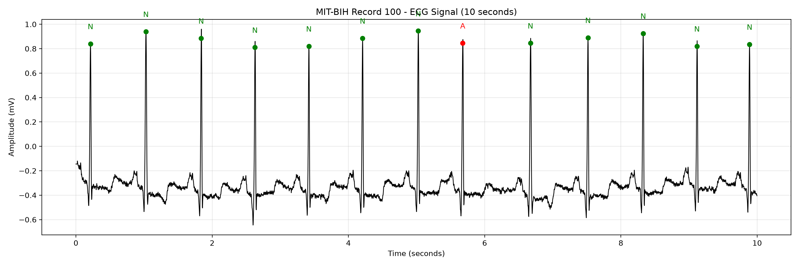 | 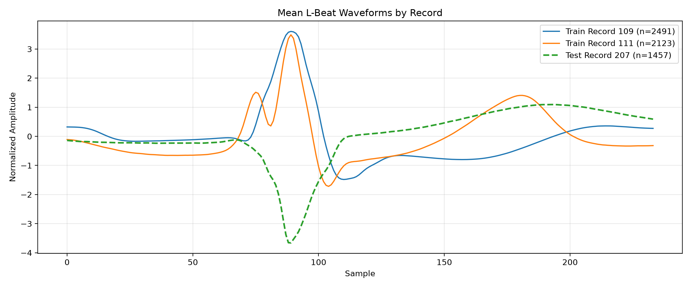 |
| Record 100 | Train 109·111 / Test 207 |

| 이상 박동 유형별 Recall | 극성 정렬 전후 LSTM-AE 성능 |
|:---:|:---:|
| 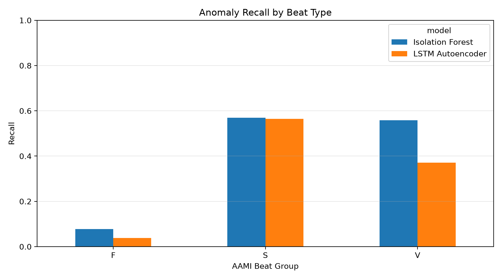 | 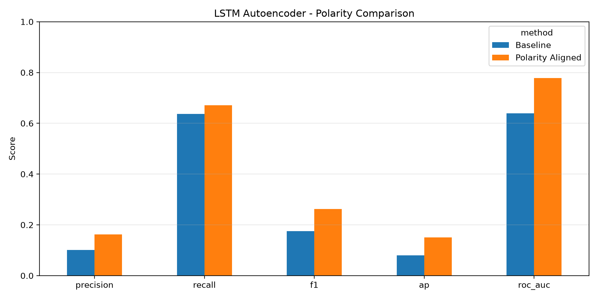 |

위 그래프에는 최초 Test 평가와 이후 Validation 기반 실험의 결과가 함께 포함되어 있습니다. 두 실험은 평가 데이터가 다르므로 성능 수치를 구분해 제시했습니다.

## 1. 프로젝트 개요

정상 ECG 패턴을 학습한 모델이 새로운 기록의 이상 박동을 얼마나 구분하는지 확인하고자 했습니다. Isolation Forest를 기준 모델로, LSTM Autoencoder를 시계열 재구성 모델로 사용했습니다.

최초 평가에서는 모델별 성능을 비교한 뒤, 오탐과 미탐이 특정 기록 또는 박동 유형에 집중되는지 분석했습니다. 이후 Train과 Test 기록에서 좌각차단형(L) 박동의 평균 파형이 다르게 나타나는 현상을 관찰했고, QRS의 주요 극성을 정렬하는 전처리 실험을 추가했습니다.

```text
MIT-BIH ECG (48 records)
    ↓
박동 주석 필터링 · 234-sample 심박 추출 · Z-score 정규화
    ↓
기록 그룹 기준 Train / Validation / Test 분할
    ↓
Isolation Forest / LSTM Autoencoder
    ↓
이상 점수 · 임계값 선정 · 성능 평가
    ↓
기록별/유형별 오류 분석
    ↓
극성 정렬 전처리 비교 실험
```

## 2. 데이터 및 전처리

데이터는 [MIT-BIH Arrhythmia Database (PhysioNet, v1.0.0)](https://physionet.org/content/mitdb/1.0.0/)를 사용했습니다. 총 48개 기록이며, 각 기록은 360 Hz로 수집된 2채널 ECG 신호 650,000개 시점을 포함합니다. 박동 위치와 유형은 `.atr` 주석을 이용했습니다.

각 기록의 첫 번째 채널에서 주석 위치 기준 앞 90개, 뒤 144개 시점을 추출해 길이 234의 심박 데이터를 만들었습니다. 개별 심박마다 평균과 표준편차를 이용해 Z-score 정규화를 적용했습니다. 첫 번째 채널의 유도 종류는 기록마다 다를 수 있습니다.

### 라벨 정의

| 그룹 | MIT-BIH 주석 | 이진 라벨 |
|---|---|---|
| N | `N`, `L`, `R`, `e`, `j` | 0 |
| S | `A`, `a`, `J`, `S` | 1 |
| V | `V`, `E` | 1 |
| F | `F` | 1 |
| 제외 | `/`, `f`, `Q` 및 비박동 주석 등 | 분석 제외 |

AAMI 기반 그룹 분류를 참고했습니다. 여기서 정상(0)은 본 실험의 N 그룹을 의미합니다. L·R 박동이 의학적으로 정상 동성 박동과 같다는 의미는 아닙니다.

### 데이터 분할

기록 그룹 기준으로 분할하고 `201`과 `202`는 동일 대상자 기록으로 묶었습니다. 분할 간 그룹 중복이 없는지 코드로 검사했습니다.

| 데이터 | 전체 | 정상 | 이상 |
|---|---:|---:|---:|
| Train | 61,154 | 61,154 | 0 |
| Validation | 16,939 | 15,591 | 1,348 |
| Test | 15,410 | 13,850 | 1,560 |

모델은 Train의 정상 박동만 학습했습니다. Validation 라벨로 임계값을 선정하고 Test로 최초 모델을 평가했습니다. 이 분할은 AAMI의 DS1/DS2 표준 분할과 동일하지 않습니다.


## 3. 모델 및 최초 Test 결과

Isolation Forest는 심박의 234개 값을 하나의 벡터로 입력받습니다. `n_estimators=200`, `max_samples=256`으로 설정했으며 `-score_samples()`를 이상 점수로 사용했습니다.

LSTM Autoencoder는 `(234, 1)` 시퀀스를 입력받습니다. Hidden Size는 64, Latent Dimension은 32이며, 입력 파형과 복원 파형 사이의 MSE를 이상 점수로 사용했습니다. 학습에는 Adam Optimizer를 사용했습니다.

두 모델의 이상 탐지 임계값은 Validation에서 F1이 최대가 되는 지점으로 결정했습니다.

### 최초 Test 성능 (15,410개 심박)

| Model | Precision | Recall | F1 | AP | ROC-AUC |
|---|---:|---:|---:|---:|---:|
| Isolation Forest | 0.3510 | 0.5519 | 0.4291 | 0.4657 | 0.8813 |
| LSTM Autoencoder | 0.3026 | 0.3891 | 0.3404 | 0.4244 | 0.7952 |

이번 분할에서는 Isolation Forest가 모든 주요 지표에서 높은 성능을 보였습니다. AP는 Scikit-learn의 `average_precision_score`로 계산했습니다.

| Isolation Forest Confusion Matrix | LSTM-AE Confusion Matrix |
|:---:|:---:|
| 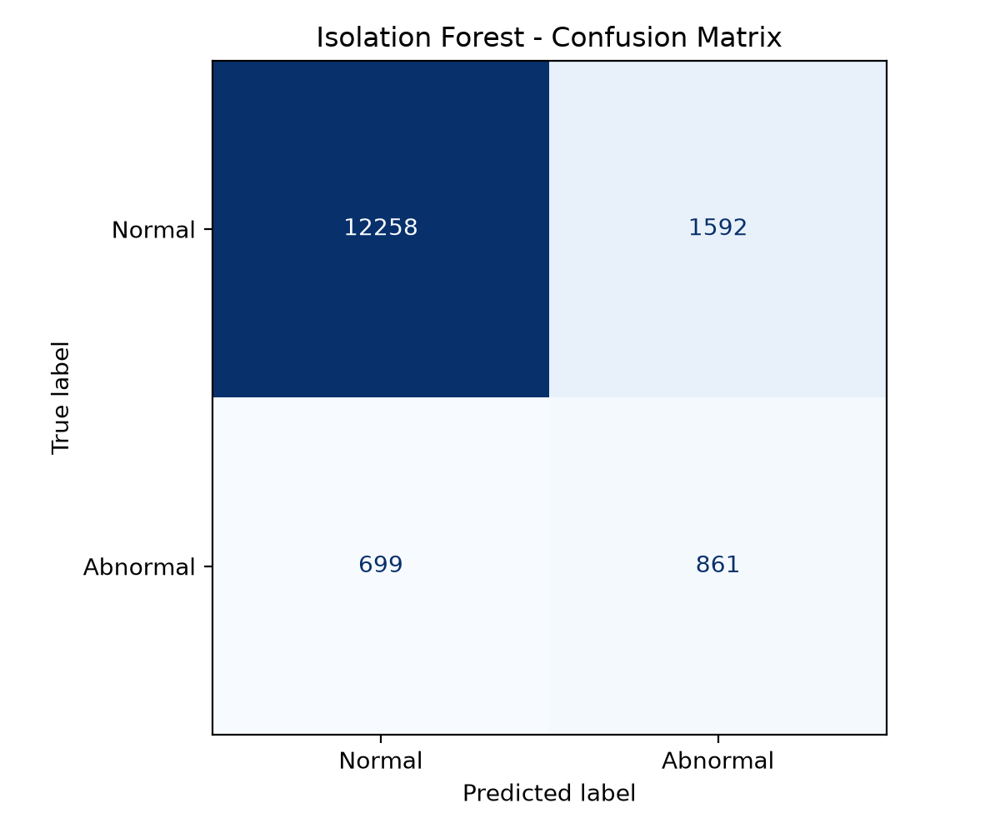 | 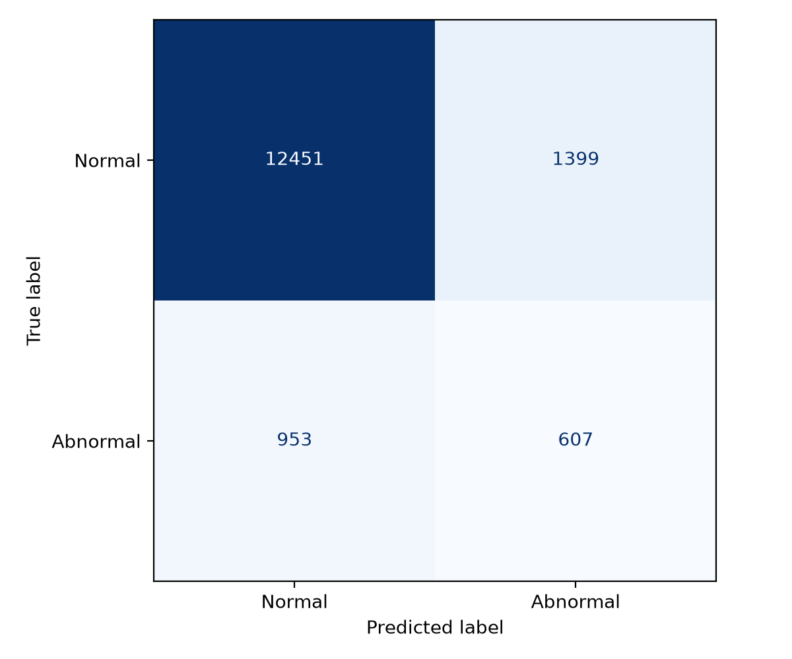 |

| Isolation Forest ROC | Isolation Forest Precision–Recall |
|:---:|:---:|
| 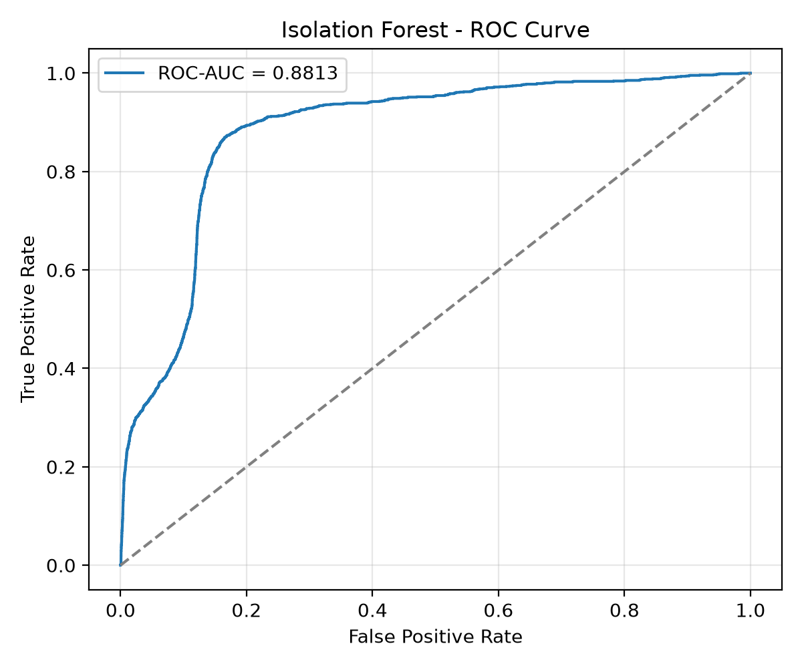 | 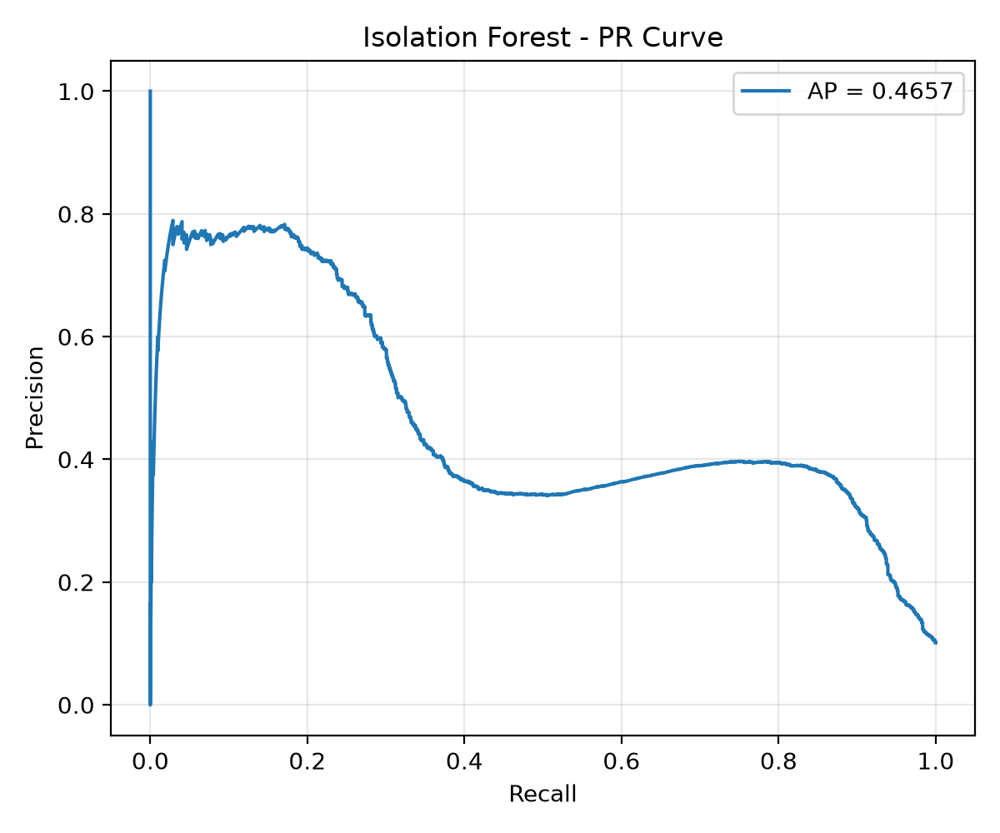 |

## 4. 오류 분석

### Record 207의 L 박동 오탐

Test의 오탐을 기록별로 확인한 결과, Record 207에서 다수의 오류가 발생했습니다.

| Model | Test 전체 FP | Record 207 FP | Record 207 L 박동 FP |
|---|---:|---:|---:|
| Isolation Forest | 1,592 | 1,434 | 1,432 / 1,457 |
| LSTM Autoencoder | 1,399 | 1,303 | 1,303 / 1,457 |

Record 207의 L 박동 1,457개 중 Isolation Forest는 1,432개, LSTM Autoencoder는 1,303개를 이상으로 분류했습니다. 반면 같은 기록의 R 박동에서는 오탐이 거의 발생하지 않았습니다.

Train의 L 박동 4,614개는 Record 109와 111에만 포함되어 있었습니다. 이 두 기록과 Record 207의 평균 파형을 비교했을 때 QRS 부근에서 주요 편향의 방향이 반대로 나타났습니다.


이 결과로 기록 간 파형 분포 차이가 오탐에 영향을 미쳤을 가능성을 검토했습니다. 다만 평균 파형 차이만으로 오류의 직접적인 원인을 확정할 수는 없습니다.

### 이상 박동 유형별 성능

| 이상 그룹 | Test 샘플 | Isolation Forest Recall | LSTM-AE Recall |
|---|---:|---:|---:|
| S | 193 | 0.5700 | 0.5648 |
| V | 1,341 | 0.5585 | 0.3706 |
| F | 26 | 0.0769 | 0.0385 |

F 그룹은 샘플이 26개로 적으므로 성능 해석에 주의가 필요합니다.

| 유형별 Recall | 기록 그룹별 F1 |
|:---:|:---:|
|  | 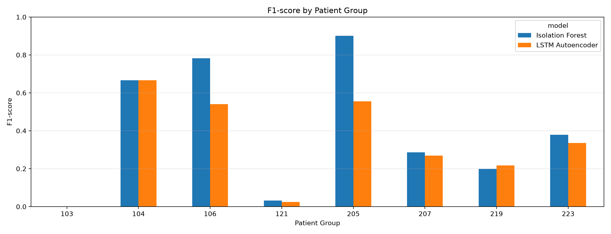 |

### 오분류 파형

아래 그래프는 Test에서 발생한 오탐, 미탐 및 두 모델이 모두 틀린 사례 중 각 조건의 앞쪽 5개 심박을 표시한 것입니다. 임의 추출된 대표 표본은 아닙니다.

| False Positive | False Negative |
|:---:|:---:|
| 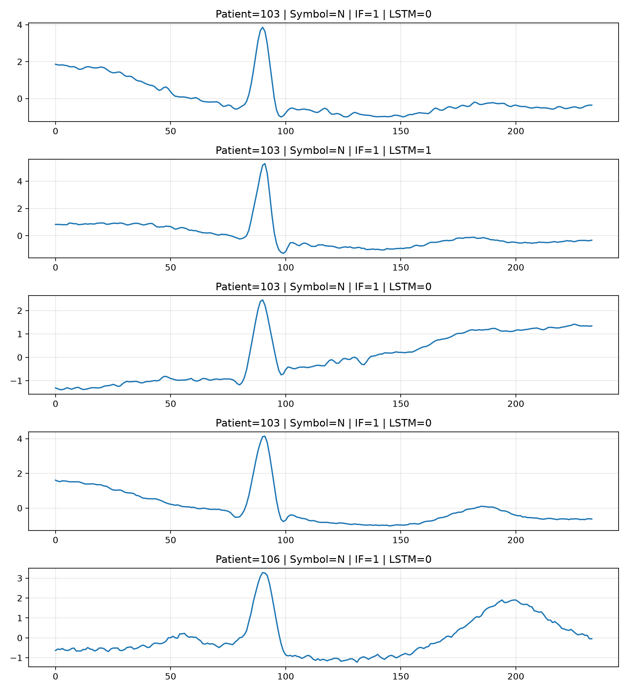 | 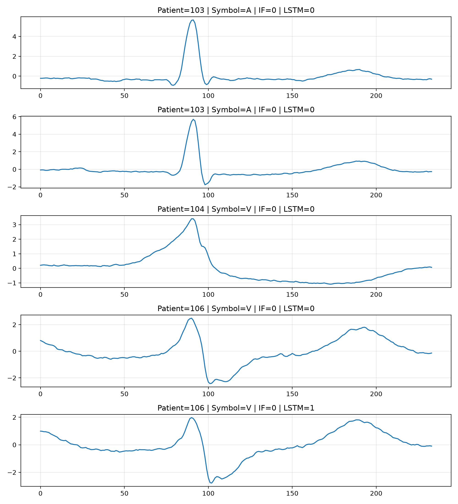 |

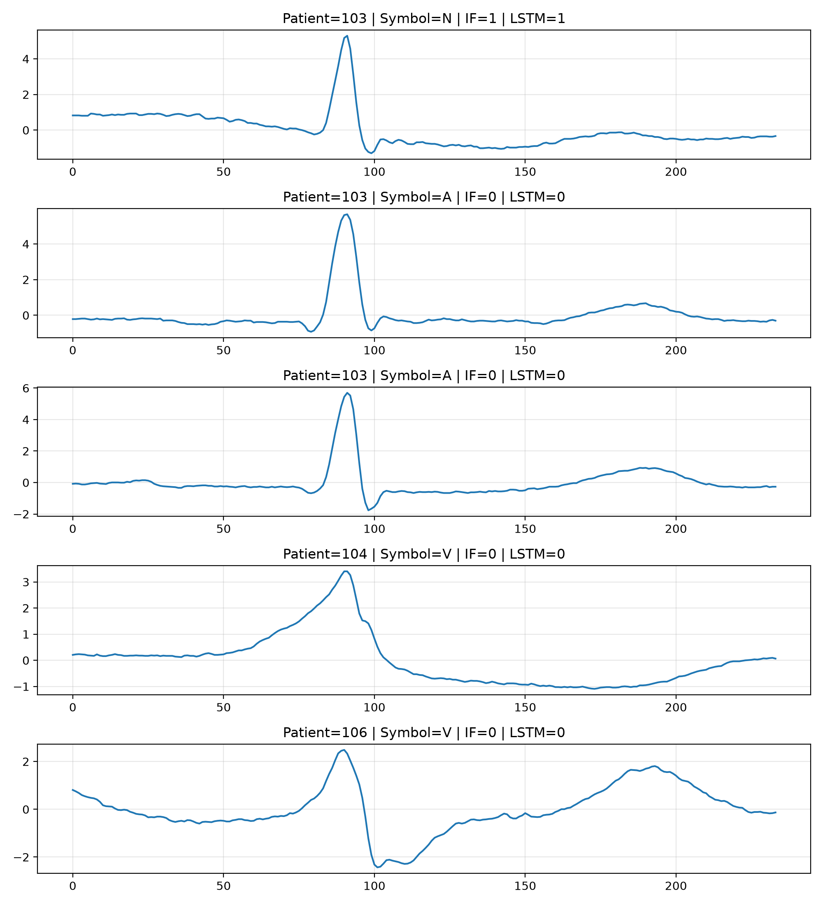

## 5. 극성 정렬 실험

Record 207의 파형 차이를 확인한 후 QRS의 주요 편향을 양의 방향으로 정렬하는 전처리를 실험했습니다. 심박의 R-peak 기준 인덱스 90±35 구간에서 절댓값이 가장 큰 샘플을 찾고, 그 값이 음수이면 전체 파형에 −1을 곱하는 방식입니다.

이 가설은 최초 Test에 대한 사후 분석에서 도출했기 때문에, 기존 Test 결과를 개선 성능의 독립 검증으로 재사용하지 않았습니다. 대신 기존 Validation을 아래 기록 그룹으로 나누어 탐색적으로 비교했습니다.

| 구분 | 기록 그룹 | 용도 |
|---|---|---|
| Calibration | 203, 214, 231 | 모델 선택 및 임계값 결정 |
| Evaluation | 108, 113, 201/202, 222 | 전처리별 성능 비교 |

Evaluation은 10,135개 심박(이상 641개)으로 구성되었습니다. 이 그룹에는 L 박동이 없으므로, 이 실험으로 Record 207의 L 박동 오탐 문제가 해결됐는지는 확인할 수 없습니다.

### 전처리 전후 성능 비교 (Evaluation)

| Model | Preprocessing | Precision | Recall | F1 | AP | ROC-AUC |
|---|---|---:|---:|---:|---:|---:|
| Isolation Forest | Baseline | 0.0919 | 0.2543 | 0.1350 | 0.1066 | 0.7221 |
| Isolation Forest | Polarity Aligned | 0.1750 | 0.6178 | 0.2727 | 0.2629 | 0.7901 |
| LSTM Autoencoder | Baseline | 0.1013 | 0.6365 | 0.1748 | 0.0799 | 0.6394 |
| LSTM Autoencoder | Polarity Aligned | 0.1629 | 0.6708 | 0.2622 | 0.1503 | 0.7786 |

두 모델 모두 이 Evaluation 그룹에서 F1과 AP가 상승했습니다. LSTM-AE는 FP가 3,619개에서 2,209개로 감소했고, TP는 408개에서 430개로 증가했습니다. 개선된 입력에서 LSTM-AE의 최적 체크포인트는 47 Epoch였으며, Baseline은 50 Epoch였습니다.


| LSTM-AE Baseline 학습 곡선 | LSTM-AE Polarity Aligned 학습 곡선 |
|:---:|:---:|
| 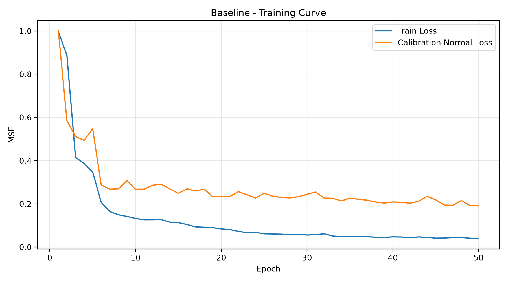 | 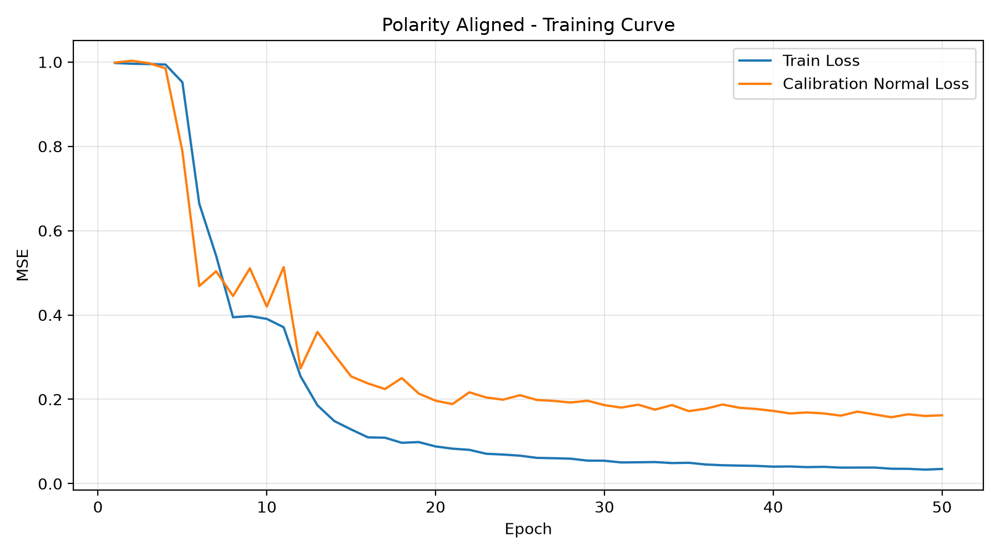 |

| Baseline Confusion Matrix | Polarity Aligned Confusion Matrix |
|:---:|:---:|
| 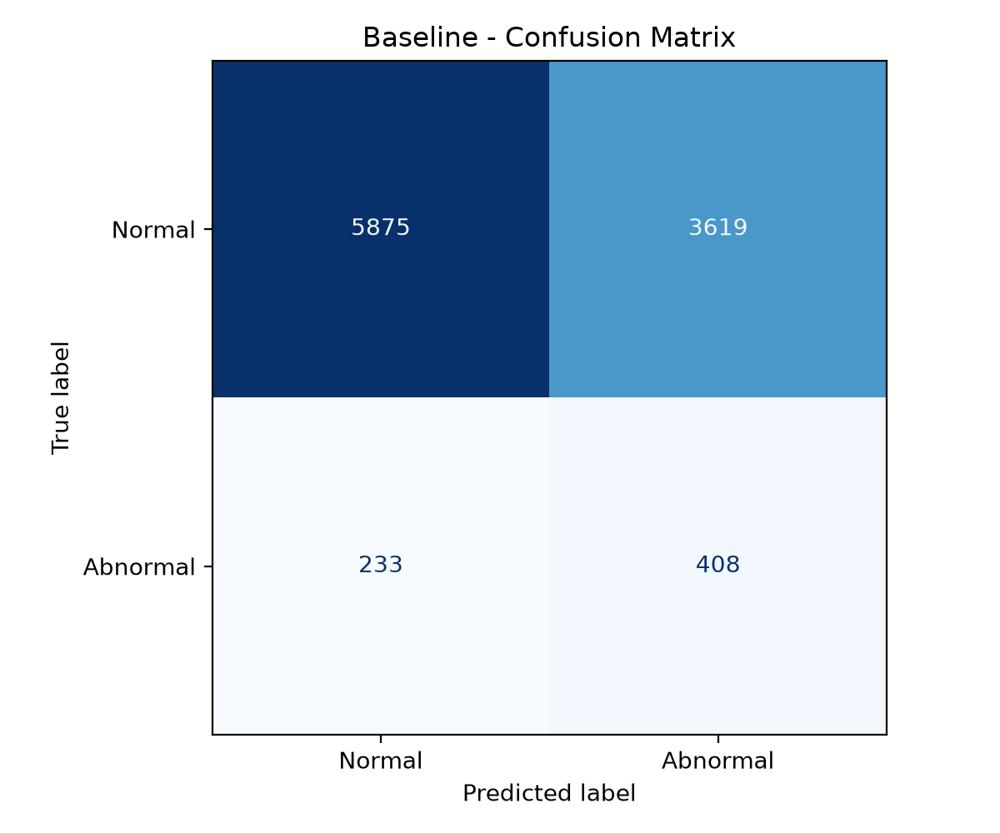 | 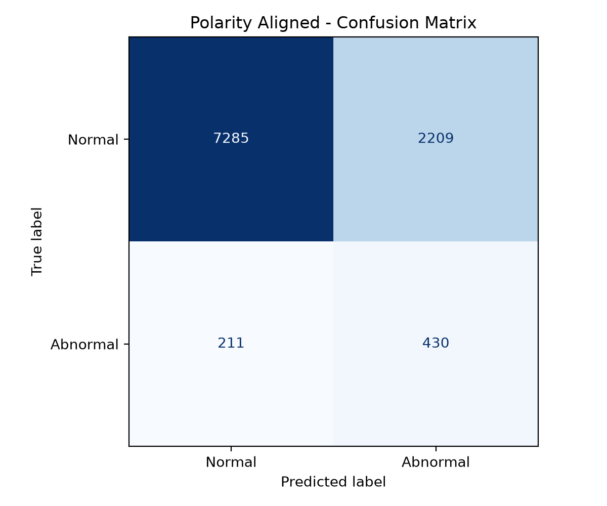 |

Isolation Forest에서는 Validation 그룹에 대해 GroupShuffleSplit을 10회 반복해 민감도도 확인했습니다. 평균 F1은 0.1994에서 0.2996으로, AP는 0.1861에서 0.2939로 변화했습니다. 동일한 소수의 기록을 반복 사용한 결과이므로 독립된 10회 외부 검증을 의미하지는 않습니다.

## 6. 결과 및 한계

최초 Test에서는 Isolation Forest가 LSTM Autoencoder보다 높은 성능을 기록했습니다. 오류를 분석하면서 Record 207의 L 박동에 오탐이 집중된다는 점을 확인했고, Train 기록과의 평균 파형 차이를 관찰했습니다. 이후 진행한 극성 정렬 실험에서는 두 모델 모두 Validation 기반 Evaluation에서 F1과 AP가 개선되었습니다.

다만 극성 정렬 가설은 최초 Test 결과를 살펴본 뒤 설정했으므로, 개선 효과를 독립적으로 검증했다고 볼 수 없습니다. 개선 실험의 Evaluation에는 L 박동도 포함되지 않았습니다. 또한 기록별 ECG 유도 차이, 일부 박동 유형의 분석 제외, 제한된 환자 그룹 수, LSTM 학습 초기화에 따른 변동성도 결과에 영향을 줄 수 있습니다.

추가 검증을 진행한다면 평가 그룹을 사전에 고정하고 여러 시드에서 재학습한 결과를 비교할 계획입니다. 본 프로젝트는 공개 ECG 데이터의 오프라인 분석이며 의료 진단이나 실시간 환자 감시에 사용하도록 검증된 모델이 아닙니다.

## 7. 실행 방법

실험 환경은 Windows, Python 3.14.3, PyTorch 2.14.1+cu130, NVIDIA RTX 3070입니다.

### 저장소 및 환경 구성

```powershell
git clone https://github.com/wmjin9312/ecg-anomaly-detection.git
cd ecg-anomaly-detection
py -3.14 -m venv .venv
.\.venv\Scripts\Activate.ps1
python -m pip install -r requirements.txt
```

`requirements.txt`는 실험 환경에서 `pip freeze`로 생성했습니다. CUDA 지원 PyTorch는 환경별로 설치 방법이 다를 수 있어 [공식 설치 안내](https://pytorch.org/get-started/locally/)를 참고해야 합니다.

### 데이터 다운로드

[PhysioNet MIT-BIH 데이터셋](https://physionet.org/content/mitdb/1.0.0/)을 `data/raw/mitdb/`에 배치합니다. 공개 S3 버킷에 접근할 수 있다면 다음 명령을 사용할 수 있습니다.

```powershell
aws s3 sync s3://physionet-open/mitdb/1.0.0/ .\data\raw\mitdb\ --no-sign-request
```

### 데이터 전처리 및 모델 평가

```powershell
python src/verify_dataset.py
python src/eda.py
python src/preprocess.py
python src/isolation_forest.py
python src/lstm_autoencoder.py
```

### 오류 분석 및 개선 실험

```powershell
python src/error_analysis.py
python src/check_annotations.py
python src/analyze_l_beats.py
python src/polarity_experiment.py
python src/polarity_robustness.py
python src/lstm_polarity_experiment.py
```

원본 및 가공 데이터, 학습 가중치(`.pt`)는 GitHub에 포함하지 않았습니다. 코드 실행 시 앞 단계에서 생성한 `.npz` 파일들이 필요합니다.

## 8. 저장소 구조

```text
ecg-anomaly-detection/
├── README.md
├── requirements.txt
├── src/
│   ├── download.py
│   ├── inspect_data.py
│   ├── verify_dataset.py
│   ├── eda.py
│   ├── preprocess.py
│   ├── isolation_forest.py
│   ├── lstm_autoencoder.py
│   ├── error_analysis.py
│   ├── check_annotations.py
│   ├── analyze_l_beats.py
│   ├── polarity_experiment.py
│   ├── polarity_robustness.py
│   └── lstm_polarity_experiment.py
├── data/                    # 저장소에서 제외
│   ├── raw/mitdb/
│   └── processed/
└── results/
    ├── figures/
    ├── isolation_forest/
    ├── lstm_autoencoder/
    ├── error_analysis/
    ├── l_beat_analysis/
    ├── polarity_experiment/
    ├── polarity_robustness/
    └── lstm_polarity_experiment/
```

## 참고 자료

- [MIT-BIH Arrhythmia Database (PhysioNet)](https://physionet.org/content/mitdb/1.0.0/)
- [WFDB Python](https://wfdb.readthedocs.io/)
- [Scikit-learn Isolation Forest](https://scikit-learn.org/stable/modules/generated/sklearn.ensemble.IsolationForest.html)
- [PyTorch LSTM](https://docs.pytorch.org/docs/stable/generated/torch.nn.LSTM.html)
